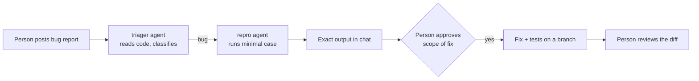

# 🛰️ TechPulse Triage Room

> Two AI agents and a human find, reproduce and fix a real bug in a real Java project, through Switch.

🎬 **Demo video (recap):** <PASTE YOUTUBE LINK HERE>
🔧 **Fix branch in TechPulse:** https://github.com/priyagupta35/techpulse/tree/fix-url-dedup

**Jump to:** [The hackathon](#-the-hackathon) · [Problem](#-the-problem) · [How it works](#-how-it-works) · [Real example](#-real-example) · [How Switch is used](#-how-switch-is-used) · [Run it](#-run-it-yourself) · [Limitations](#-limitations-and-lessons)

## 🏁 The hackathon
**Flip the Switch** (Nov 4–7, 2026) was an online hackathon by **WeMakeDevs × DevTools Academy**. The challenge: connect AI agents such as Claude Code, Codex, Cursor and OpenCode to team chat platforms using **Switch**, and build practical workflows where agents and humans complete real tasks together. This project is my entry for the **Best Business Workflow** track.

## 🎯 The problem
Bug reports are vague, and someone has to read the code, guess the cause and write a reproduction before a fix can start. This room does the triage and reproduction in chat and keeps a person in charge of what changes.

## ⚙️ How it works

1. A person posts a bug report in `triage-room` (Mattermost, bundled with Switch).
2. `@triager` reads the real code, restates the report, classifies it and hands bugs to `@repro`.
3. `@repro` builds the smallest case, runs it against the real code and posts the exact output.
4. A person approves the fix and sets its scope.
5. The fix and tests are made on a branch, and the person reviews the diff.

## 🐛 Real example
Run on Nov 5, 2026, against my Java project **TechPulse** (a tech-news aggregator).

| Step | What happened |
|---|---|
| Bug | Duplicate articles appeared despite de-duplication by URL |
| Finding | The duplicate check compared the raw URL, so `…/java-21` and `…/java-21/` were both saved |
| Reproduction | Two items, same title, URLs differing by a trailing slash → `Saved: 2, Skipped: 0` |
| Approved fix | Normalize the URL (trailing slash, host case, `#fragment`, `utm_*` params) before the check; keep other params like `?id=5`; no database index |
| Result | 5 JUnit tests pass (`Tests run: 5, Failures: 0, Errors: 0`) |
| Commits | `f8d86f0` (fix), `cb1ac79` (tests) on branch `fix-url-dedup` |

## 🔌 How Switch is used
- **Server:** Switch Console with a local server in Docker, on Windows
- **Agents:** `triager` and `repro` (instructions in [`/agents`](agents)), provider **OpenCode**, model `opencode/deepseek-v4.1-flash-free`
- **Room:** `triage-room` in Mattermost, with the instructions in [`room-instructions.md`](room-instructions.md)
- **Context:** both agents' working directory was a local clone of TechPulse
- The agents are generic, so the same setup could be pointed at another repository

## 🚀 Run it yourself

Click to expand the setup steps

1. Install Docker Desktop, Switch Console and OpenCode.
2. Create the two agents from `/agents` with the OpenCode provider and the model above.
3. Create a Mattermost room, add both agents, and paste `room-instructions.md`.
4. Clone TechPulse and set both agents' directory to it.
5. Post a bug report and follow the thread.
6. To check the fix: `git checkout fix-url-dedup`, then `.\mvnw.cmd test`.

## ⚠️ Limitations and lessons

Click to expand

- The agent run and thread are from Nov 5. On submission day the Mattermost bridge would not start on my Windows machine (Console is early access), so the demo video is a recap, not a live run.
- Free models are slower and rate-limited.
- Console on Windows is early access and shows a provider warning even though OpenCode works.
- The repro agent committed and pushed to the branch on its own, so every diff must be reviewed.
- Existing duplicate rows in a database would still need a one-off cleanup.
- Git history of this repo contains an earlier, unrelated simulated prototype that is not part of this submission.

